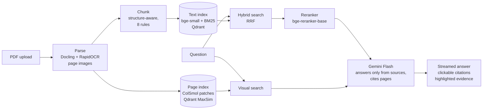

# DocAI

**Ask a PDF anything, and see the exact passage behind every answer.**

DocAI is a multimodal retrieval-augmented generation (RAG) app for real-world PDFs: financial
reports full of tables, research papers with formulas, chart-heavy economic reports, faded
scans and handwritten notes. Every answer cites its pages. Clicking a citation opens the page
and highlights the passage the answer came from.

On a 55-question test set over 6 documents: **96% of answers correct, 0% wrong, 100% of
citations grounded** in the sources the model was given.

---

## What it handles

| Document | Example question | Answer | Why it is hard |
|---|---|---|---|
| Apple 10-K (123 pages, 59 tables) | What were Apple's total net sales in 2026? | $478,834 million [p. 29] | The figure sits in a table; the year only appears as a column header |
| IMF World Economic Outlook | Which country group had a negative structural primary balance change in 2025? | Emerging market and developing economies, about −0.3 points [p. 9] | The value exists only as a bar in a chart |
| Gazette of India, 1960 (faded scan) | Who was granted earned leave for 17 days? | Shri S. S. Saith, 12–28 January 1960 [p. 4] | OCR turned "earned leave for 17 days" into `ear   s       ty`; the answer is not in the extracted text at all |
| Handwritten class notes (11 scanned pages) | What is RAG and why is it used? | A cited summary drawn from pages 3–7 | Every page is a scan of handwriting |

The Gazette answer is the clearest case: **no text-based RAG system can produce it**. It comes
from retrieving the page image and letting a vision-language model read the faded line.

---

## How it works



1. **Parse** ([`backend/ingest/parse.py`](backend/ingest/parse.py)): Docling reads layout,
   reading order and tables (as Markdown) and gives every element a bounding box. Each page is
   classified as digital, scanned or blank; scanned pages get OCR (forced re-OCR when a scan
   carries a bad hidden text layer). Every page is saved as an image.
2. **Chunk** ([`backend/ingest/chunk.py`](backend/ingest/chunk.py)): rule-based and
   structure-aware: headings start chunks and are repeated in them, paragraphs stay whole (≤300
   words), tables stay whole or are split by rows with their header repeated, table intro
   sentences stay with their table, and tiny chunks are merged.
3. **Index** ([`backend/ingest/index.py`](backend/ingest/index.py),
   [`visual_index.py`](backend/ingest/visual_index.py)): each chunk gets a dense vector
   (`BAAI/bge-small-en-v1.5`) and a sparse BM25 vector in one Qdrant point. Scanned pages and
   pages with figures are also embedded as images with ColSmol (ColPali family): about 1,000
   patch vectors per page, scored with MaxSim.
4. **Retrieve** ([`backend/retrieval/search.py`](backend/retrieval/search.py)): hybrid search
   (dense + BM25 fused with Reciprocal Rank Fusion) gives 20 candidates; a cross-encoder
   reranker keeps the best 5. Up to 3 page images are chosen from visual search and from the
   pages of confident text hits.
5. **Answer** ([`backend/retrieval/ask.py`](backend/retrieval/ask.py)): Gemini Flash answers
   only from the sources, cites pages, and says when the answer is not in the document.

**App:** a FastAPI backend ([`backend/api/`](backend/api/)) with background processing for
uploads, live status and streamed answers (Server-Sent Events), and a Next.js frontend
([`frontend/`](frontend/)) with a PDF viewer, streamed chat and clickable citations that
highlight the source regions on the page.

---

## Results

### Retrieval: is the passage with the answer among the 5 sources?

55 questions over 6 documents, in 9 categories (tables, formula tables, numbers, exact terms,
synonyms, prose, charts, clean scans, faded scans).

| Retrieval mode | Answer in top 5 (hit@5) | Mean reciprocal rank |
|---|---|---|
| Dense (bge-small) | 89% | 0.71 |
| BM25 | 85% | 0.73 |
| Hybrid (dense + BM25, RRF) | 95% | 0.77 |
| **Hybrid + reranker** | **96%** | **0.86** |
| Visual (ColSmol), 18 chart and scan questions | 94% | 0.87 |

Dense and BM25 fail on **different** questions: dense misses exact terms and formula-heavy
tables (Attention paper Table 1 at rank 15), BM25 misses synonyms ("employees" vs "full-time
equivalent", rank 6). Hybrid search misses neither.

### Answers: is the final answer right?

Same pipeline as the app (rerank, top 5 chunks, up to 3 page images). Answers by
`gemini-3.6-flash`; judged by a **different** model (`gemini-3.8-flash`) against reference
answers; 15 random verdicts checked by hand (15/15 agreement).

| | |
|---|---|
| Correct | **96%** (53/55) |
| Partially correct | 2% (a chart value misread) |
| Wrong | **0%** |
| "Not in the document" | 2% (the one question retrieval missed; the system declined instead of guessing) |
| Cites the page holding the answer | 100% |
| Cites only pages it was given | 100% |
| Average time per answer | 7.0 s |

Faded and clean scans were 100% correct. The only weakness is reading **exact values** from
charts: the right series and timing, but peak values overestimated.

Full logs of every experiment, including failures, are in [`NOTES.md`](NOTES.md).

---

## What I learned building it

- **A small test set gave the wrong conclusion.** On 11 questions the reranker added nothing
  over hybrid search; on 55 it was clearly best (MRR 0.77 → 0.86), mostly on tables (0.30 →
  0.67). The 11-question result would have dropped the best component.
- **Chunking decisions are measurable.** Attaching "The following table shows net sales…" to its
  table turned a failed answer ("I couldn't find this") into "$478,834 million [p. 29]".
  Repeating table headers in every split part created 41 near-duplicate chunks on a scanned
  name list until headers were repeated only when short.
- **Evaluating answers found a bug that retrieval scores could not.** With page images in the
  prompt, the model cited `[Source 4, p. 2, 3; Page image, p. 3]`; the citation parser read
  nothing, so those answers had no clickable citations. A prompt rule plus a more tolerant
  parser took evidence citations from 91% to 100%.
- **The evaluation also caught an error in my own ground truth:** on a dual-axis chart the
  model correctly picked the series on the right-hand scale, which I had misread.
- **Frontend bugs worth knowing:** PDF.js crashed in Safari (ReadableStream is not
  async-iterable there, fixed with a polyfill); the viewer kept jumping back to page 1 because
  pages that were still loading suspended the nearest React Suspense boundary, which hid and
  remounted the whole viewer (fixed with a boundary per page plus `startTransition`).
- **On a MacBook Air,** ColQwen2.5 (3B) and ColSmol both crashed while loading their adapter
  onto the Apple GPU in bfloat16; loading in float32 on the CPU first and then moving to the
  GPU fixed it. ColSmol-256M indexes about 3–7 seconds per page.

---

## Run it locally

**Requirements:** Python 3.12+, Node.js 18.18+, and a [Gemini API key](https://aistudio.google.com).

### Backend

```bash
cd backend
python -m venv .venv
source .venv/bin/activate
pip install -r requirements.txt
cp .env.example .env            # then put your GEMINI_API_KEY in .env
uvicorn api.main:app --port 8000
```

The first start downloads the models (a few GB: Docling, bge-small, BM25, the reranker and
ColSmol). On a Mac, add `VISUAL_MODEL=vidore/colSmol-256M` to `.env`.

### Frontend

```bash
cd frontend
npm install
echo "NEXT_PUBLIC_API_URL=http://localhost:8000" > .env.local
npm run dev
```

Open <http://localhost:3000>, choose **Open the app**, and drop a PDF on the left.

### Command line (optional)

The pipeline also runs step by step without the app (from `backend/`, with the server stopped:
local Qdrant allows one process at a time):

```bash
python ingest/parse.py samples/report.pdf                 # → data/processed/<doc_id>/
python ingest/chunk.py data/processed/<doc_id>
python ingest/index.py add data/processed/<doc_id>
python -m ingest.visual_index add data/processed/<doc_id>
python -m retrieval.ask "What were total net sales in 2026?" --doc <doc_id>

python -m eval.run_retrieval       # retrieval evaluation, all modes
python -m eval.run_answers         # answer evaluation with an LLM judge
```

---

## Limitations

- **Chart values are approximate,** and peaks tend to be overestimated; answers say when a value
  is read from a chart.
- **The test set is small and written by one person** from the same documents, mostly
  single-fact questions. Real questions are vaguer.
- **The judge is a different model from the same family** as the answering model; a human
  spot-check agreed on all 15 sampled verdicts, all of which were "correct" ones.
- **Chart answers vary between runs** (a chart question moved from partial to correct between
  two runs).
- **Local Qdrant** allows one process at a time; a production setup would run Qdrant as a
  service.

## Next steps

- **GraphRAG mode** for multi-hop questions across pages and documents
- **Agentic RAG mode:** an agent that plans, chooses between hybrid, visual and graph search,
  calculates and verifies
- Multi-hop and vaguer questions in the test set, and several runs per question

## Tech stack

Docling, RapidOCR, PyMuPDF, fastembed (bge-small-en-v1.5, BM25, bge-reranker-base),
ColSmol-256M (colpali-engine), Qdrant, Gemini Flash, FastAPI, Next.js, React, react-pdf,
Tailwind CSS

---

Built by Ayesha Memon.