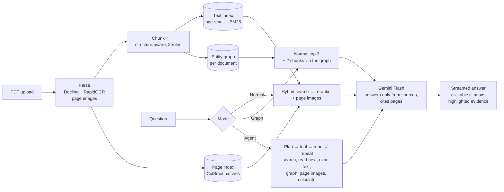

# DocAI

**Ask a PDF anything, and see the exact passage behind every answer.**

DocAI is a multimodal retrieval-augmented generation (RAG) app for real-world PDFs: financial
reports full of tables, research papers with formulas, chart-heavy economic reports, faded scans
and handwritten notes. Every answer cites its pages; clicking a citation opens the page and
highlights the passage the answer came from.

It answers in three modes:

| Mode | How it finds the evidence | Best for |
|---|---|---|
| **Normal** | Hybrid search (dense + BM25) → reranker, plus page images for charts and scans | single facts (96% correct) |
| **Graph** | Normal search + a walk on an entity graph of the document | a fact connected to another one on a different page |
| **Agent** | An LLM agent that plans, searches several times, reads around tables, calculates and checks | questions where each step depends on the last |

On 103 test questions over 6 documents, **no mode gave a single wrong answer**. On the hardest
multi-hop questions the agent answered **100%** correctly, against 50% for normal search.

---

## What it handles

| Document | Example question | Answer | Why it is hard |
|---|---|---|---|
| Apple 10-K (123 pages, 59 tables) | What were Apple's total net sales in 2026? | $478,834 million [p. 29] | The figure sits in a table; the year only appears as a column header |
| IMF World Economic Outlook | Which country group had a negative structural primary balance change in 2025? | Emerging market and developing economies, about −0.3 points [p. 9] | The value exists only as a bar in a chart |
| Gazette of India, 1960 (faded scan) | Who was granted earned leave for 17 days? | Shri S. S. Saith, 12–28 January 1960 [p. 4] | OCR turned "earned leave for 17 days" into `ear   s       ty`; the answer is not in the extracted text at all |
| Apple 10-K | Which product grew fastest in 2026, and why? | iPhone, +21% [p. 29], due to higher sales of Pro models [p. 29] | The reason only makes sense once you know it is the iPhone (Agent mode) |

The Gazette answer comes from retrieving the page image and letting a vision-language model read
the faded line: **no text-based RAG system can produce it**.

---

## How it works



1. **Parse** ([`backend/ingest/parse.py`](backend/ingest/parse.py)): Docling reads layout, reading
   order and tables (as Markdown) with a bounding box for every element. Pages are classified as
   digital, scanned or blank; scanned pages get OCR. Every page is saved as an image.
2. **Chunk** ([`backend/ingest/chunk.py`](backend/ingest/chunk.py)): rule-based: headings start
   chunks and are repeated in them, paragraphs stay whole (≤ 300 words), tables stay whole or are
   split by rows with their header, table intro sentences stay with their table, tiny chunks are
   merged.
3. **Index**: each chunk gets a dense vector (`bge-small-en-v1.5`) and a sparse BM25 vector in one
   Qdrant point. Scanned pages and pages with figures are embedded as images with ColSmol
   (ColPali family): about 1,000 patch vectors per page, scored with MaxSim.
4. **Retrieve and answer** ([`backend/retrieval/`](backend/retrieval/)): hybrid search gives 20
   candidates, a cross-encoder reranker keeps 5, up to 3 page images are added, and Gemini Flash
   answers only from those sources, citing pages, or says the answer is not in the document.

### Graph mode ([`backend/graph/`](backend/graph/))

*"Which GPUs trained the Transformer, and what TFLOPS value was assumed for that GPU?"* The second
half is answered by a footnote on another page that never mentions training, so normal search
misses it. GraphRAG builds a map of each document:

1. **Extract:** Gemini lists each chunk's entities and the relationships the text states, each with
   an exact quote; the code drops any relationship whose quote is not really in the chunk.
2. **Merge:** the same thing named differently ("NVIDIA P100 GPU", "P100") becomes one node: exact
   names merge automatically, similar names only if Gemini confirms, and a guard stops chains of
   wrong merges.
3. **Connect:** layout edges link entities to their chunks and chunks to their section.
4. **Search:** normal search keeps its best 3 chunks; a one-step walk from their entities adds the
   2 most strongly connected chunks (5 in total, the same budget as normal mode).

### Agent mode ([`backend/agent/`](backend/agent/))

A plain Python loop (no framework). Each round, Gemini reads its notes (the question, a checklist
of its parts, everything found so far), writes one line of reasoning and calls **one tool**:
`text_search`, `graph_search`, `visual_search`, `read_next` (the passages around a table),
`find_exact` (an exact word or number) or `calculate`. The rules are enforced in code, not just
asked for: it may only stop when every part of the question has a source a tool really returned,
it cannot repeat a search, and it gets at most 5 rounds. The final answer uses the same answer
step and citations as normal mode, and the app shows each step live.

---

## Results

### Single-fact questions (55 questions, 6 documents)

| Retrieval mode | Answer in top 5 (hit@5) | Mean reciprocal rank |
|---|---|---|
| Dense (bge-small) | 89% | 0.71 |
| BM25 | 85% | 0.73 |
| Hybrid (dense + BM25, RRF) | 95% | 0.77 |
| **Hybrid + reranker** | **96%** | **0.86** |
| Visual (ColSmol), 18 chart and scan questions | 94% | 0.87 |

**Answers** (judged by a different model against a hand-written answer key; 15/15 agreement with a
human spot-check): **96% correct, 0% wrong**, 100% citing the page with the answer, 100% citing only
pages the model was given, 7 s per answer. Faded and clean scans: 100% correct.

Graph mode on the same questions: 96% correct; Agent mode: 95%; both 0% wrong. The agent's one
miss is the faded-scan question above: the answer exists only in the page image, which normal mode
always sends for scanned documents but the agent did not choose to look at.

### Multi-step questions: all modes

| Correct answers | Normal | Normal, 7 chunks | Graph | Query decomposition | **Agent** |
|---|---|---|---|---|---|
| Bridge questions (12) | 50% | 67% | 67% | 75% | **100%** |
| Compare questions (14) | 86% | 93% | 93% | **100%** | 93% |
| Hard chained questions (12) | 50% | – | 67% | 75% | **83%** |
| Wrong answers | 0% | 0% | 0% | 0% | **0%** |
| Time per answer | ~10 s | 9 s | ~14 s | ~14 s | 16–28 s |

- **Bridge** questions need fact 1 to know what fact 2 is ("Which segment had the lowest sales, and
  how did currency affect it?"); **compare** questions name both facts; **hard** questions chain
  facts from different pages and need a calculation.
- **Two controls** check that the agent's gain is real: normal search with 7 chunks (as many as the
  agent reads) and query decomposition (several queries written at the start, no loop).
  The agent's edge is on questions where **the next search depends on what was just found**:
  it finds "Japan", *then* searches Japan's currency effect.
- **Graph** reaches with 5 chunks what normal search needs 7 for; graph-only search was worse than
  normal search, so the graph works as a helper.

---

## What I learned building it

- **The query matters more than the tool.** For "Which product grew fastest, and why?", no single
  query found both the sales table and the reason, with any search method. The reason only
  becomes findable once you know the answer is "iPhone", which is why a step-by-step agent wins.
- **The reranker is the wrong judge for the second fact.** It asks "does this passage answer the
  question?", and the second fact of a bridge question never does on its own. In Graph mode it
  threw away the right footnote; picking graph passages by connection raised a test from 57% to
  86%.
- **Check *why* a result was found, not only whether.** One early Graph "success" came from a date
  entity ("2026") that touches every page; investigating it uncovered two real bugs.
- **Control experiments change the story.** The agent read more passages than normal search, so I
  re-ran normal search with as many passages, and query decomposition, before claiming the gain.
- **A small test set gave the wrong conclusion.** On 11 questions the reranker added nothing; on
  55 it was clearly best (MRR 0.77 → 0.86).
- **Evaluating answers found bugs retrieval scores could not:** citations written as
  `[Source 4, p. 2, 3; Page image, p. 3]` were not clickable (evidence citations 91% → 100% after
  the fix), and the evaluation caught a mistake in my own answer key.
- **Frontend:** PDF.js crashed in Safari (ReadableStream is not async-iterable there); the viewer
  jumped back to page 1 because loading pages suspended the whole viewer (fixed with a Suspense
  boundary per page plus `startTransition`).

---

## Run it locally

**Requirements:** Python 3.12+, Node.js 18.18+, and a [Gemini API key](https://aistudio.google.com).

### Backend

```bash
cd backend
python -m venv .venv
source .venv/bin/activate
pip install -r requirements.txt
cp .env.example .env            # then put your GEMINI_API_KEY in .env
uvicorn api.main:app --port 8000
```

The first start downloads the models (a few GB: Docling, bge-small, BM25, the reranker and
ColSmol). On a Mac, add `VISUAL_MODEL=vidore/colSmol-256M` to `.env`.

### Frontend

```bash
cd frontend
npm install
echo "NEXT_PUBLIC_API_URL=http://localhost:8000" > .env.local
npm run dev
```

Open <http://localhost:3000>, choose **Open the app**, drop a PDF on the left, and pick a mode in
the chat header.

### Graph mode (optional, per document)

Building a graph costs one Gemini call per chunk (the 123-page 10-K: 418 calls, about an hour), so
it runs from `backend/` with the server stopped (local Qdrant allows one process at a time):

```bash
python -m graph.extract data/processed/<doc_id>
python -m graph.build data/processed/<doc_id>
python -m graph.index_entities add data/processed/<doc_id>
```

### Evaluation

```bash
python -m eval.run_retrieval --modes rerank graph+rerank
python -m eval.run_answers --mode agent
```

---

## Limitations

- **The test set is small and written by one person** from the same documents (103 questions;
  12 bridge and 12 hard), with one run per question; agent paths and chart readings vary between
  runs.
- **The judge is from the same model family** as the answering model; a human spot-check agreed on
  all 15 sampled verdicts.
- **Chart values are approximate** (peaks tend to be read high).
- **Graph mode** cannot tell which connection matters when many entities are common, and its 2
  extra passages can push out a useful one; graphs are built from the command line.
- **Agent mode** is the slowest (16–28 s, 3–4 planning calls), reads more passages, and only uses
  page images when it decides to (it missed one faded-scan answer that way).
- **Local Qdrant** allows one process at a time; production would run it as a service.

## Next steps

- **Routing:** normal search or query decomposition by default, the agent only when a question
  needs dependent steps
- A "Build graph" button in the app, and graphs across several documents
- Larger, public multi-hop benchmarks and several runs per question

## Tech stack

Docling, RapidOCR, PyMuPDF, fastembed (bge-small-en-v1.5, BM25, bge-reranker-base), ColSmol-256M
(colpali-engine), Qdrant, NetworkX, Gemini Flash, FastAPI, Next.js, React, react-pdf, Tailwind CSS

---

Built by Ayesha Memon.